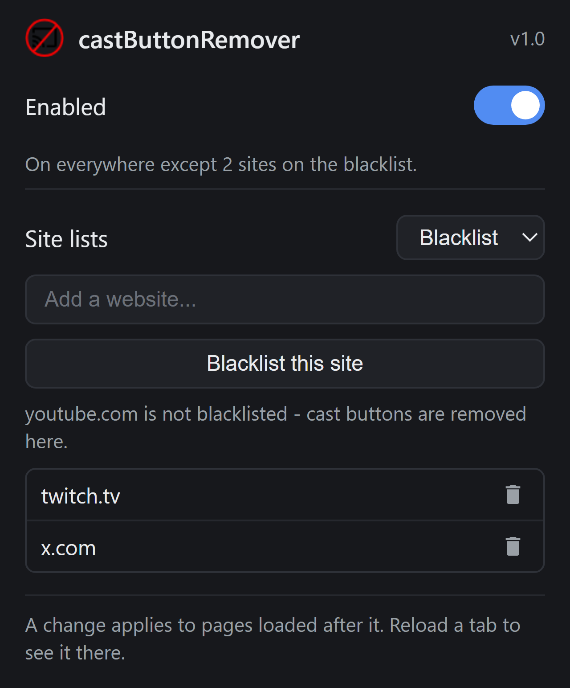

Direct download latest:  https://github.com/finnuen/castButtonRemover/releases/download/1.1/castButtonRemover.crx

# castButtonRemover

Removes and disables Google Cast, Chromecast and AirPlay-style "cast to device" buttons on every website, including the ones built into video players. Works in Chrome, Edge, Brave, Opera, Vivaldi and other Chromium browsers (version 119 or newer).



## Install

Unzip `castButtonRemover.zip`. It holds one folder, also named `castButtonRemover`, which is the extension itself.

1. Keep that folder somewhere permanent — the browser reads it from there every time it starts, so don't delete or move it.
2. Open `chrome://extensions` (or `edge://extensions`, `brave://extensions`).
3. Turn on **Developer mode** (top right).
4. Click **Load unpacked** and choose the `castButtonRemover` folder (the one that contains `manifest.json`).
5. Reload any tabs that were already open. Optional: open the extension's Details and turn on **Allow in Incognito**.

`castButtonRemover.crx` is the same extension, signed and packed in one file. Chrome and Edge refuse a `.crx` that did not come from a web store unless the extension-install policy allows it, so the zip is the install path that always works; use the `.crx` only if your browser accepts it. Do not install both — they are the same extension and would fight over one ID.

The extension needs access to all sites; that is what lets it run inside every page. It contains no network code and sends nothing anywhere. The only thing it stores is its own settings: the switch and the two site lists.

## The popup

Click the toolbar icon.

- **Enabled** — the whole extension on or off. Off means nothing is blocked anywhere, and the site lists are kept for when you switch it back on.
- **Site lists** — pick **Blacklist** or **Whitelist**, then add the current site with one click or type a domain into the box.

  | Mode | What it means |
  | --- | --- |
  | Blacklist | Blocked everywhere, except the listed sites. The default, and an empty list blocks everywhere. |
  | Whitelist | Blocked only on the listed sites. An empty whitelist blocks nothing. |

  A list entry also covers its subdomains: `youtube.com` covers `www.youtube.com` and `m.youtube.com`.

A change applies to pages loaded after it — reload a tab to see it there. Nothing is left half-applied: the browser decides before the page runs whether the extension should touch it at all, so a site you have switched off gets no patched APIs, no stylesheet and no blocked request.

## What it does

Five layers, each working on its own, so one failing never takes the others with it:

1. **Network**: the Google Cast sender scripts (`cast_sender.js`, `cast_framework.js`) are blocked, so pages cannot build a Cast button.
2. **Page APIs**: the Presentation API is removed, the Remote Playback API refuses to find or start devices, and pages that wait for the Cast SDK are told Cast is unavailable.
3. **Media elements**: every `<video>` and `<audio>` (including ones inside shadow DOM) gets `disableremoteplayback`, which removes the browser's own cast button from the video controls.
4. **Stylesheet**: known cast buttons (YouTube, Video.js, JW Player, Shaka, Plyr, Bitmovin, Media Chrome, Jellyfin and others) are hidden before the page paints.
5. **Detector**: unknown cast buttons are recognised by their name, label, icon or icon-font glyph, including inside open and closed shadow DOM, and re-checked as the page changes.

Buttons are hidden rather than deleted, so sites built on React, Vue and similar frameworks keep working.

## Check that it is running

Open any website, press F12, choose the Console tab and paste:

```js
[document.createElement('video').disableRemotePlayback, typeof PresentationRequest, 'presentation' in navigator]
```

Expected result: `[true, 'undefined', false]`. In a normal browser it is `[false, 'function', true]`. On a site you have blacklisted, or with the switch off, you should also get the normal-browser result — that is the extension standing down.

## What an extension cannot remove

Chrome's own **Cast...** menu entry and toolbar icon belong to the browser, not to web pages. To switch those off as well, run `optional-browser-policy/turn-off-browser-cast.reg` as administrator (Windows) and restart the browser. This sets the standard `EnableMediaRouter` policy; the browser will then show "managed by your organization". Undo it with `restore-browser-cast.reg`. Edge ignores this policy on profiles signed in with a Microsoft account.

## If a site ever misbehaves

Switch the extension off for that site (add it to the blacklist) or off entirely, reload, and check whether the problem is gone. Some Cast SDK scripts being blocked will leave a `net::ERR_BLOCKED_BY_CLIENT` line in that page's console; that is the extension doing its job, not a fault.

## Building it

The version lives in `extension/manifest.json` and nowhere else.

```powershell
powershell -ExecutionPolicy Bypass -File tools\build.ps1
```

Writes `build/castButtonRemover_v<version>.zip` and `build/castButtonRemover_v<version>.crx`. The build needs PowerShell, Node (for the key and the generated hide rules) and `crx3` (`npm install -g crx3`). The first build creates `key.pem`, which fixes the extension ID — keep it out of the repository and back it up.

`extension/` is loaded as-is; there is no bundler and no dependency to install. The icons are rendered from `assets/icon.svg`.
